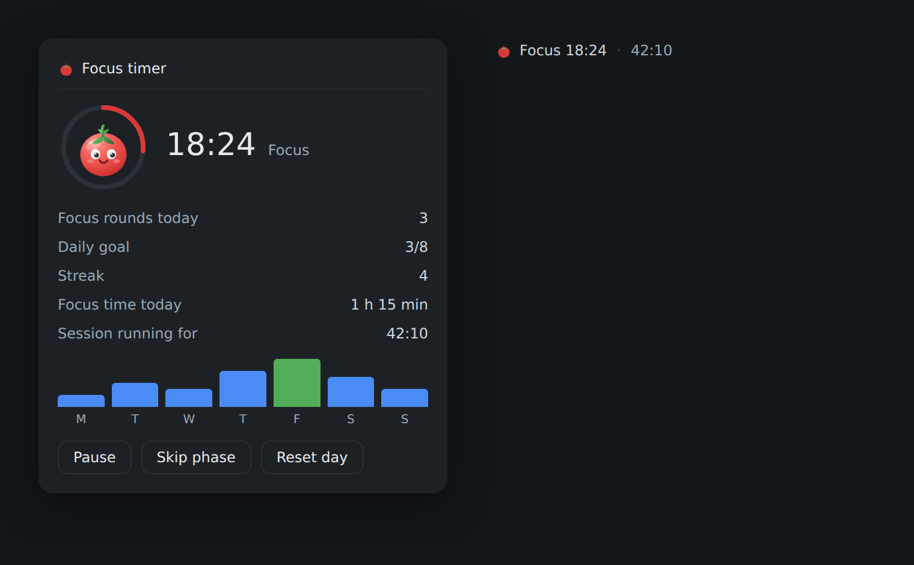
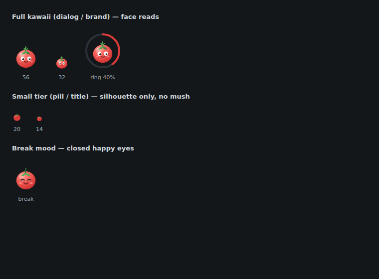

<div align="center">


<h1>🍅 dsh-pomodoro-timer</h1>

<p>A Pomodoro focus timer for the DeepSeek Harness Web UI — daily tracking, goals & streaks, phase-change signals, and agent tools.</p>

<p>
  <strong>English</strong> · <a href="#deutsch">Deutsch</a>
</p>

<p>
  <a href="https://www.npmjs.com/package/@einfachllm/dsh-pomodoro-timer"></a>
  <a href="https://www.npmjs.com/package/@einfachllm/dsh-pomodoro-timer"></a>
  <a href="https://www.npmjs.com/package/@einfachllm/dsh-pomodoro-timer"></a>
  <a href="https://github.com/deepseek-ai/deepseek-harness"></a>
  <a href="https://github.com/einfachllm/dsh-pomodoro-timer/blob/main/LICENSE"></a>
</p>

</div>

A [DeepSeek Harness](https://github.com/deepseek-ai) bundle that adds a Pomodoro focus timer to the web composer dock: a kawaii tomato pill under the chat input, a focus dialog with a progress ring and weekly chart, configurable durations in the General settings, phase-change signals, and three agent tools so your assistant can read, control, and analyze the timer.

## Screenshots

| Focus dialog (dark) | Mascot detail tiers |
|---|---|
|  |  |

The mascot keeps its full face at dialog size and degrades to a clean silhouette in the 14 px pill, so it never turns to mush. Break phases swap to a happy closed-eye expression; the ring is colored per phase (focus red, break green, long break amber).

## Features

- **Composer dock pill** — phase and remaining time next to the shipped session statistics; click opens the timer dialog (Start/Pause, Skip phase, Reset day).
- **Pomodoro cycle** — 25 min focus → 5 min break, long break (15 min) after every 4th completed round; phases auto-continue or pause per setting.
- **Persistent tracking** — completed rounds, focus time, history, and streak survive harness restarts (stored under `$DSH_HOME/storages`) and are shared across open tabs.
- **Goals & streaks** — configurable daily goal, current streak, and a last-7-days bar chart in the dialog.
- **Phase-change signals** — short beep (with a Preview button), optional desktop notification, and an in-app toast when a phase completes.
- **Agent integration** — the model can see your focus state (opt-out), optionally gets a break hint when a round ends (opt-in), and a webhook POST fires on natural phase completion.
- **Settings** (General section): durations, rounds before long break, automatic start, signals, daily goal, agent integration, webhook. UI in English, German, and Chinese.
- **Agent tools** — `pomodoro_status`, `pomodoro_control`, `pomodoro_stats`. UI buttons and tools run the same Host-owned state machine.

## Requirements

- DeepSeek Harness `>=0.2.2-rc.1 <0.3.0` with a profile and web GUI; Node.js ≥ 24.9.
- No build step and no install scripts.

## Install

Ask your DSH agent to install it, or use the profile's plugin manager:

```
install_bundle: "@einfachllm/dsh-pomodoro-timer"
```

Or add the Discover index in Settings → Plugins → Discover:

```
https://raw.githubusercontent.com/einfachllm/dsh-pomodoro-timer/main/index.json
```

After installation, reload the web page — the tomato pill appears under the composer next to the session statistics.

## Configuration

Settings → General:

| Row | Controls |
|---|---|
| Pomodoro lengths | focus / break / long-break minutes, rounds before long break |
| Start phases automatically | all phases / breaks only / manually |
| Phase-change signal | beep (+ Preview), desktop notification |
| Daily goal | rounds per day |
| Agent integration | focus context (on by default), break hint (off by default) |
| Webhook | optional URL receiving a JSON `phase_complete` event |

## Tools

| Tool | Purpose |
|---|---|
| `pomodoro_status` | Read phase (`idle`/`focus`/`break`/`long`), running state, remaining ms, today's rounds/focus time, goal, streak, history. |
| `pomodoro_control` | `start`, `pause`, `skip` (jump without counting), `reset` (clear today's tracking). |
| `pomodoro_stats` | Today's totals, daily goal, streak, and per-day history (up to 30 days) with totals. |

## Deutsch

Ein DeepSeek-Harness-Bundle mit Pomodoro-Fokus-Timer im Composer-Dock: Kawaii-Tomaten-Pill unterm Eingabefeld, Fokus-Dialog mit Fortschrittsring und Wochenchart, persistente Tages-Tracks (Runden, Fokuszeit, Serie, Ziel), einstellbare Längen in den allgemeinen Einstellungen, Signalton/Desktop-Benachrichtigung/In-App-Toast beim Phasenwechsel sowie drei Agent-Tools (`pomodoro_status`, `pomodoro_control`, `pomodoro_stats`). Oberfläche auf Deutsch, Englisch und Chinesisch.

Installation über den Plugin-Manager des Profils (npm-Spec `@einfachllm/dsh-pomodoro-timer`) oder über den Discover-Index, danach die Weboberfläche neu laden. Einstellungen → Allgemein → Pomodoro-Zeilen.

## Development & publishing

Plain ES modules, no build step. `node --check index.js client.js` validates syntax. Releases are published to npm by GitHub Actions on `v*` tags (requires an `NPM_TOKEN` secret with publish access to the `@einfachllm` scope).

## License

[MIT](./LICENSE)
